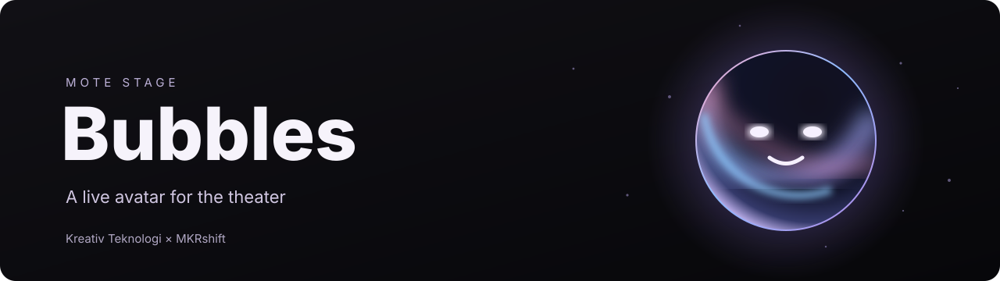

# Bubbles · MOTE Stage

Bubbles is a live theater avatar by [Kreativ Teknologi](https://github.com/Kreativ-Teknologi) and [MKRshift](https://github.com/MKRshift). An actor can puppeteer Bubbles with a webcam, microphone, and programmable cues. The desktop app runs offline and opens a separate audience window.

## Get Bubbles

Download the [latest release](https://github.com/Kreativ-Teknologi/mote-stage-desktop/releases/latest) for Apple silicon, Intel Mac, or Windows x64. The Mac builds are unnotarized and the Windows installer is unsigned.

- **Actor** has live controls, camera and avatar previews, and a scrollable script reader.
- **Emote Layout** lets you arrange buttons and combine actions, shapes, and saved looks.
- **Settings** has actor calibration, appearance presets, and optional NDI output.

See the [build and operation guide](docs/build-and-operation.md) for setup and source builds.

## License

MKRshift has a dedicated [commercial license](LICENSE.md) for the original project software. [Third-party components](THIRD_PARTY_NOTICES.md) retain their own licenses.
